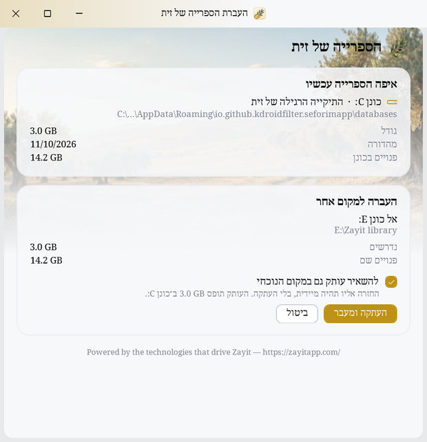
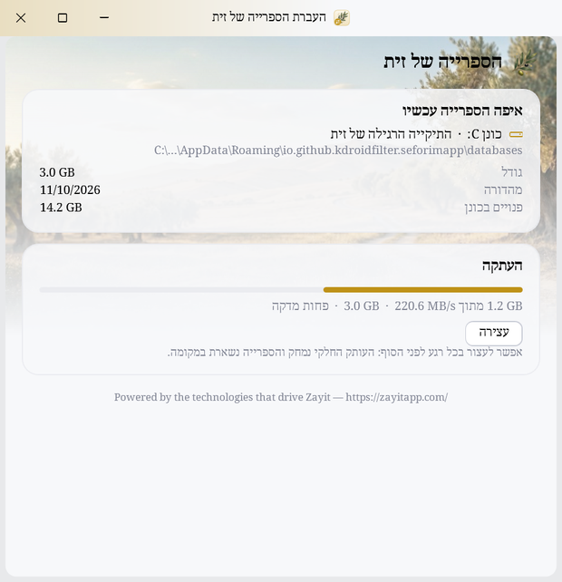
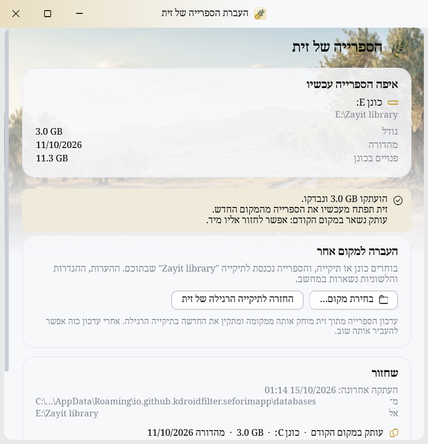

<div dir="rtl">


# העברת הספרייה של זית

**Move the desktop Zayit library to another drive or folder (an external drive too), and back, or install it there straight from its release. A 0.7 MB Windows tool.**

הספרייה של זית למחשב שוקלת כמה ג׳יגה־בייט, והיא נמצאת תמיד בדיסק C. הכלי הקטן הזה מעביר אותה לכל מקום אחר, למשל לכונן שני, לכונן חיצוני או לכרטיס זיכרון, ומכוון את זית אליה. אפשר גם לחזור, ואפשר להשאיר עותק במקום הקודם כדי שהחזרה תהיה מיידית.

הוא גם מתקין את הספרייה ישר לשם, מהאינטרנט או מקובצי ההפצה שכבר הורדו, עוד לפני שזית מתקינה אותה בעצמה. כך לא צריך את 15 ה־GB הפנויים שזית דורשת בכונן C.

> כלי לא רשמי. אינו קשור למפתח של זית.

## צילומי מסך

| בחירת המקום | ההעתקה | אחרי ההעברה: אפשר לחזור |
|:---:|:---:|:---:|
|  |  |  |

## מה הוא עושה

- **מראה איפה הספרייה עכשיו:** הכונן, התיקייה, הגודל, המהדורה והמקום הפנוי. אם הספרייה לא נמצאת, למשל כשהכונן החיצוני מנותק, הכלי אומר את זה.
- **מעביר:** בוחרים כונן או תיקייה, והספרייה נכנסת לתיקייה `Zayit library` בתוכם.
  - הספרייה מועתקת, ואז נבדק שגודל כל קובץ זהה.
  - רק אחרי הבדיקה זית מכוונת למקום החדש, והעותק הישן נמחק.
  - באותו כונן ההעברה מיידית, כי הקבצים רק עוברים תיקייה.
  - פס התקדמות מראה מהירות וזמן שנותר. אפשר לעצור בכל רגע, והספרייה נשארת במקומה.
- **מתקין ישר למקום שבוחרים:** גם במחשב שזית עוד לא התקינה בו ספרייה, וגם במקום ספרייה קיימת.
  - מהאינטרנט: המהדורה האחרונה יורדת מ־GitHub, מאותו מקום שזית מורידה ממנו, ונפרסת תוך כדי ההורדה, בלי לשמור עותק שלה. אם החיבור נקטע, ההורדה ממשיכה מאותו מקום.
  - מקובצי ההפצה שכבר הורדו, למשל במחשב אחר: `seforim_bundle.tar.zst.part01`, `part02` וכן הלאה. החלקים נקראים זה אחרי זה, בלי לחבר אותם.
  - בהורדה, וכשרשימת החלקים (`seforim_bundle.tar.zst.manifest.json`) נמצאת ליד הקבצים, כל חלק נבדק מולה (sha256). בלעדיה החלקים נבדקים לפי הגודל, הרצף וסכום הביקורת של הדחיסה.
  - הספרייה נפרסת לתיקייה זמנית ליד היעד, ורק כשהכול נבדק היא נכנסת למקומה וזית מכוונת אליה. ספרייה שהייתה שם נמחקת רק אז.
  - הכלי מוציא את המקום החדש גם מרשימת הקבצים שזית מוחקת בפתיחה הבאה, אחרי עדכון שלה שלא הצליח למחוק הכול.
  - בפתיחה הראשונה זית מוצאת את הספרייה, ומדלגת על ההורדה שלה ועל בדיקת המקום בכונן C.
  - כך אפשר גם לעדכן ספרייה בכרטיס במקומה, בלי העדכון של זית, שמוחק אותה ומתקין את החדשה בכונן C.
  - אם כבר יש ספרייה במקום שבוחרים, אפשר לעבור אליה בלי להתקין.
- **משאיר עותק, לבחירתכם בכל העברה:** עם עותק במקום הקודם, החזרה מיידית ואין צורך להעתיק שוב.
- **משחזר:**
  - חזרה מיידית לעותק שנשאר.
  - החזרה למקום הקודם: הכלי מעתיק בחזרה, בודק, ורק אז מוחק.
  - מעבר בין עותקים.
  - מחיקת עותק, אחרי אישור נוסף.
  - כשהספרייה חסרה: החזרת זית לתיקייה הרגילה שלה.
- **בודק לפני כל פעולה:**
  - שזית סגורה.
  - שיש מספיק מקום ביעד, ושהיעד אינו FAT32 (ראו "חשוב לדעת").
  - שזית נסגרה כראוי (הקובץ `seforim.db-wal` ריק).
  - שאין כבר ספרייה ביעד. אם יש, אפשר לעבור אליה בלי להעתיק.

ההערות, ההגדרות, הלשוניות וההיסטוריה של זית לא זזות. הן נשארות בתיקייה של זית במחשב.

העיצוב הוא של זית: הצבע, הגופן ומצב בהיר או כהה נלקחים מההגדרות של זית במחשב.

## התקנה

1. מורידים את `ZayitMove.exe` מעמוד ה־[Releases](../../releases/latest).
2. מפעילים. אין התקנה, ואפשר להחזיק את הקובץ בכל תיקייה.

הקובץ אינו חתום דיגיטלית, ולכן Windows SmartScreen עלול להזהיר בפעם הראשונה. כדי להמשיך לוחצים על "מידע נוסף" ואז על "הפעל בכל זאת".

**דרישות:**
- Windows 10 או 11. ה־.NET Framework 4.8 שהכלי צריך כבר מובנה בהם.
- זית למחשב. כדי להעביר צריך שתהיה לה ספרייה; כדי להתקין, לא.

## חשוב לדעת

- **כונן חיצוני** צריך להיות מחובר, ובאותה אות כונן, כשפותחים את זית. בדיסק־און־קי החיפוש איטי יותר.
- **עדכון הספרייה מתוך זית** מוחק את הספרייה ממקומה ומתקין את החדשה בתיקייה הרגילה, בכונן C. הוא מוחק אותה עוד לפני שהוא בודק אם יש בכונן C מקום, ובלי 15 GB פנויים שם נשארים בלי ספרייה. עדיף לעדכן במקומה, בהתקנה של הכלי. גם איפוס זית מתוך ההגדרות מוחק את הספרייה, היכן שהיא.
- **כונן או כרטיס ב־FAT32** לא יכול לשמור קובץ של 4 GB ומעלה, והקובץ `seforim.db` שוקל כ־8 GB. לכן הכלי לא מעביר ולא מתקין אליו, ומציע שתי דרכים:
  - לפרמט אותו כ־exFAT. הפירמוט מוחק את כל מה שעליו.
  - להמיר אותו ל־NTFS בלי למחוק דבר, בפקודה `convert E: /fs:ntfs` בשורת פקודה של מנהל. אין דרך לחזור, וכרטיס ב־NTFS לא נקרא בטלפון. לכרטיס שמשמש גם את [פרדס](https://github.com/efrul/Pardes) עדיף exFAT.
- **ספרייה מפוצלת לחלקים** (`seforim.db`, `seforim.db001` וכן הלאה), כמו שפרדס שומר אותה בכרטיס FAT32, לא נפתחת בזית למחשב: ה־SQLite שבתוכה לא יודע לקרוא אותה. הכלי מזהה ספרייה כזו ולא מכוון אליה את זית.
- **מיקום מחוץ לתיקייה הרגילה** משתמש בהגדרה של זית עצמה. עם זאת, זית לא תומכת בו רשמית.

## איך זה עובד

זית למחשב מחפשת את הספרייה לפי הסדר הזה (`DatabasePathProvider`):
1. משתנה הסביבה `SEFORIMAPP_DATABASE_PATH`.
2. ההגדרה `database_path` של זית. ב־Windows זה `java.util.prefs`, כלומר מפתח הרישום `HKCU\Software\JavaSoft\Prefs`, בקידוד של Java.
3. התיקייה הרגילה, `%APPDATA%\io.github.kdroidfilter.seforimapp\databases`.

הכלי כותב ל־`database_path` בדיוק כמו ש־Java כותבת: אות גדולה מקבלת `/` לפניה, `\` הופך ל־`//`, ותווים שאינם ASCII נכתבים כ־`/uXXXX`. כשמשתנה הסביבה מוגדר, הוא גובר על ההגדרה, והכלי מציין את זה ומאפשר לבטל.

היסטוריית ההעברות נשמרת ב־`%APPDATA%\Zayit Move\history.tsv`. ממנה הכלי יודע לאן לחזור ואילו עותקים קיימים.

**ההתקנה.** [SeforimLibrary](https://github.com/kdroidFilter/SeforimLibrary/releases/latest) מפרסם את הספרייה כ־`seforim_bundle.tar.zst`: קובץ tar בתוך מסגרת zstd אחת, חתוך לחלקים של עד 2 GB, עם רשימת החלקים. הכלי קורא את החלקים לפי הסדר, מהדיסק או מהרשת, ובודק כל אחד בסופו מול הרשימה. בדרך הוא מפענח את ה־zstd בעצמו (`src/Zstd.cs`), כי ב־Windows 10 אין לכך כלי מובנה, וכותב את הקבצים בתהליכון נפרד, כדי שהכתיבה לכרטיס לא תעכב את הפענוח. בסוף הוא בודק את מסד הנתונים לפי הכותרת שלו, ואת `release_info.txt`, שזית משווה למהדורה המינימלית שלה.

בהתקנה הראשונה של זית, הכפתור "הבא" במסך הרישיון בודק אם כבר יש ספרייה במקום ש־`database_path` מצביע עליו, ואם היא עדכנית מספיק. אם כן, זית עוברת ישר לפרופיל ולאזור, בלי בדיקת המקום בכונן C ובלי הורדה (`LicenceScreen`, זית 0.6.6). הכלי כותב רק את `database_path`: את תנאי השימוש של זית מאשרים בזית עצמה.

## בנייה מקוד המקור

בלי Visual Studio ובלי חבילות: המהדר של C# שמגיע עם Windows מספיק.

```powershell
powershell -ExecutionPolicy Bypass -File build.ps1            # dist\ZayitMove.exe
powershell -ExecutionPolicy Bypass -File build.ps1 -Install   # וגם התקנה לתפריט התחל
dist\ZayitMove.exe --selftest C:\Temp\zayit-move-test         # בדיקה עצמית על ספריות מדומות; הדוח ב־report.txt
```

הבדיקה העצמית לא נוגעת בזית: היא משתמשת במפתח רישום, בתיקייה ובקובץ היסטוריה משלה. את ההתקנה היא בודקת על הפצה קטנה שהיא בונה בעצמה, מהדיסק ומשרת מקומי, ואת פענוח ה־zstd על דוגמה שנדחסה ב־zstd עצמו.

הבנייה ב־GitHub Actions רצה רק כשמפעילים אותה: לשונית Actions ← Build ← Run workflow. עם מספר גרסה (למשל `v1.0.1`) היא בונה, בודקת ומפרסמת Release עם הקובץ. בלי מספר גרסה היא רק בונה ובודקת.

## מבנה הפרויקט

| קובץ | תפקיד |
|---|---|
| `src/App.cs` | נקודת הכניסה |
| `src/MainWindow.cs` | החלון: איפה הספרייה, העברה, התקנה, שחזור, התקדמות |
| `src/Library.cs` | העתקה, בדיקה, הפניית זית, מחיקה, היסטוריה |
| `src/Install.cs` | ההתקנה: החלקים ורשימתם, ההורדה, הבדיקה, הפריסה, ההחלפה |
| `src/Zstd.cs` | פענוח zstd וקריאת tar |
| `src/SelfTest.cs` | הבדיקה העצמית |
| `src/Prefs.cs` | קריאה וכתיבה של ההגדרות של זית, בקידוד של Java |
| `src/Theme.cs` | העיצוב של זית: צבעים, כפתורים, כרטיסים, שורת הכותרת |
| `src/FolderPicker.cs` | חלון בחירת התיקייה של Windows |
| `assets/` | הגופן, תמונות הרקע, הענף מהלוגו והאייקון, שנכללים בתוך ה־exe, והרישיונות של הגופן ושל zstd |
| `build.ps1` | הבנייה |

## רישיון

AGPL-3.0, עם התנאים הנוספים של זית. ראו `LICENSE`.

**Powered by the technologies that drive Zayit — https://zayitapp.com/**

הכלי משתמש בתמונת הרקע ובענף מהלוגו של [זית](https://github.com/kdroidFilter/Zayit) (AGPL-3.0). הגופן Noto Serif Hebrew מופץ ברישיון SIL Open Font License 1.1, ראו `assets/OFL.txt`. פענוח ה־zstd (`src/Zstd.cs`) בנוי בחלקו לפי המפענח של [Zstandard](https://github.com/facebook/zstd), Copyright (c) Meta Platforms, Inc. and affiliates, ברישיון BSD: ראו `assets/zstd-LICENSE.txt`.

© 2026 efrul

</div>
